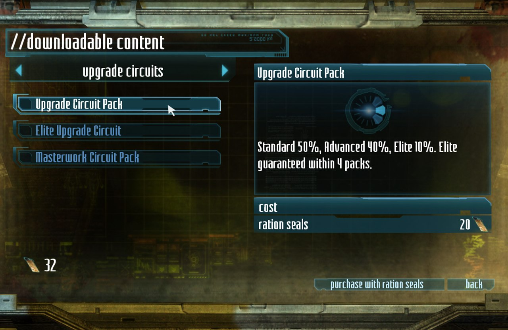
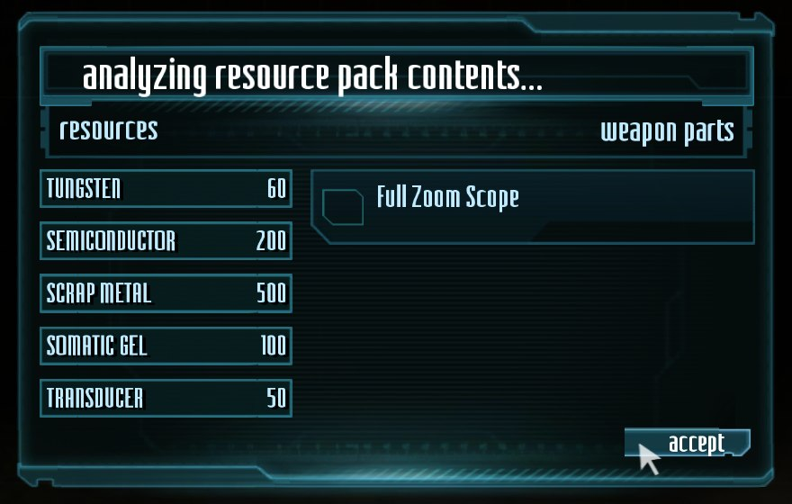
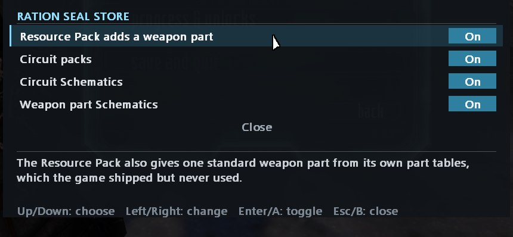

# Ration Seal Store

> **This is an add-on for the [DS3 Mod Loader](https://github.com/RHFlyer/Dead-Space-3-Mod-Loader/releases/latest), and needs version 1.0.0 or
> later.** It does nothing without the loader. Install the loader first, then this.

**Spend Ration Seals in Dead Space 3's store again: resource packs, upgrade circuits, schematics and weapon-part
unlocks.** Bought with Ration Seals, the currency you earn by playing. Never with real money.



## What you can buy

Everything here is sold for Ration Seals only. The DS3 Mod Loader itself refuses any real-money checkout for these
offers, and the store shows them without a money price or money button.

- **Resource packs**: the game's own three seal packs, back in the store. With "Resource Pack adds a weapon part"
  on, the plain Resource Pack also gives one standard weapon part from its own part tables, which the game shipped
  but never used.
- **Upgrade Circuit Pack, Elite Upgrade Circuit, Masterwork Circuit Pack** (20, 60 and 80 seals): a weapon
  upgrade circuit.
- **Circuit Schematics**: unlock circuits your save hasn't found yet.
- **Weapon part Schematics**: unlock MK-V and MK-II weapon parts you don't have yet.

A bought pack opens the game's own contents screen, as a pack from the store always did:



Each group has its own switch in the Mods panel (pause, "mods", Ration Seal Store). A change applies the next time
you open the store.



## Install

1. Install the [DS3 Mod Loader](https://github.com/RHFlyer/Dead-Space-3-Mod-Loader/releases/latest) 1.0.0 or later, if you haven't.
2. **Back up your saves**: copy `Documents\EA Games\Dead Space 3` somewhere safe.
3. Close the game. Download `SealStore-v1.0.0.zip` from [Releases](https://github.com/RHFlyer/Dead-Space-3-Ration-Seal-Store/releases/latest) and unzip it
   into the game folder, next to `deadspace3.exe` (Steam: right-click Dead Space 3 > Manage > Browse local files).
   You get `plugins\SealStore\`.
4. Start the game, pause, choose **mods**, switch **Ration Seal Store** on, and restart the game.

The Ration Seal Store is also in the DS3 Mod Loader's add-ons download. If you installed it from there, you already
have it, and unzipping a newer version from this page over it is an update: your switch and settings stay.

**Update**: close the game, unzip the new version into the game folder over the old one, and let Windows replace
the files. Your switch and settings are kept. `CHANGELOG.txt` says what changed.

**Remove**: delete `plugins\SealStore\`. What you bought stays on the save you bought it on.

Keep `ds3_seals_state.ini` in the game folder, even if you remove the mod for a while: it holds the store's pity
counts for the circuit packs.

## Good to know

- Made for the **Steam** version of Dead Space 3. Tested at 1920x1080 with keyboard and mouse.
- **Co-op hasn't been tested.** If you try it, please report what happens.
- No game files are changed on disk, the mod reads no account data and makes no network connections.
- Found a bug? [Open an issue](https://github.com/RHFlyer/Dead-Space-3-Ration-Seal-Store/issues) and attach `plugins\SealStore\seal_store.log` and `ds3_mods.log`
  from the game folder. Neither holds account details or your Windows user name, but read a log before you post it.

## Building from source

Needs Windows, Build Tools for Visual Studio 2022 ("Desktop development with C++") and CMake, as for the
[DS3 Mod Loader](https://github.com/RHFlyer/Dead-Space-3-Mod-Loader).

```
cmake -S . -B build -A Win32
cmake --build build --config Release
```

The mod is then ready in `build\plugins\SealStore\`. `scripts\package-mod.ps1` makes the release zip from it.

`ds3mod.h` is a copy of the DS3 Mod Loader's SDK header from loader 1.0.0, the oldest loader this mod works
with. `ds3mod.h.pin` says where it came from, and the build check refuses a changed copy. To learn how a mod like
this is made, start with the loader's guide, [`sdk/README.md`](https://github.com/RHFlyer/Dead-Space-3-Mod-Loader/blob/main/sdk/README.md).

## How this was made

Like the loader, this mod was made with a lot of help from AI (Claude and Codex), and I tested every release in the
game myself. More in the loader's README, ["How this was made"](https://github.com/RHFlyer/Dead-Space-3-Mod-Loader#how-this-was-made).

## Credits and licence

MIT licence ([`LICENSE.txt`](LICENSE.txt)), by RHFlyer. Like the DS3 Mod Loader, this mod never touches paid DLC,
entitlements, ownership or the game's copy protection.

Dead Space 3 is a trademark of Electronic Arts Inc. This project is not made, endorsed or supported by Electronic
Arts and contains no game files.
